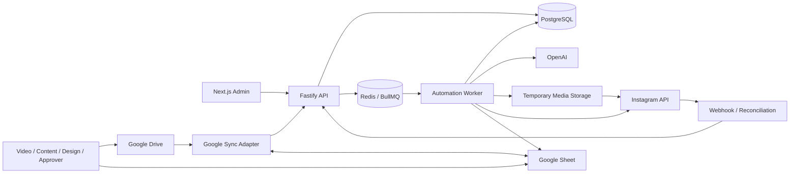
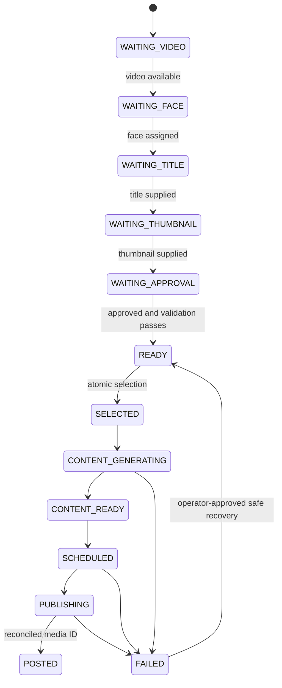
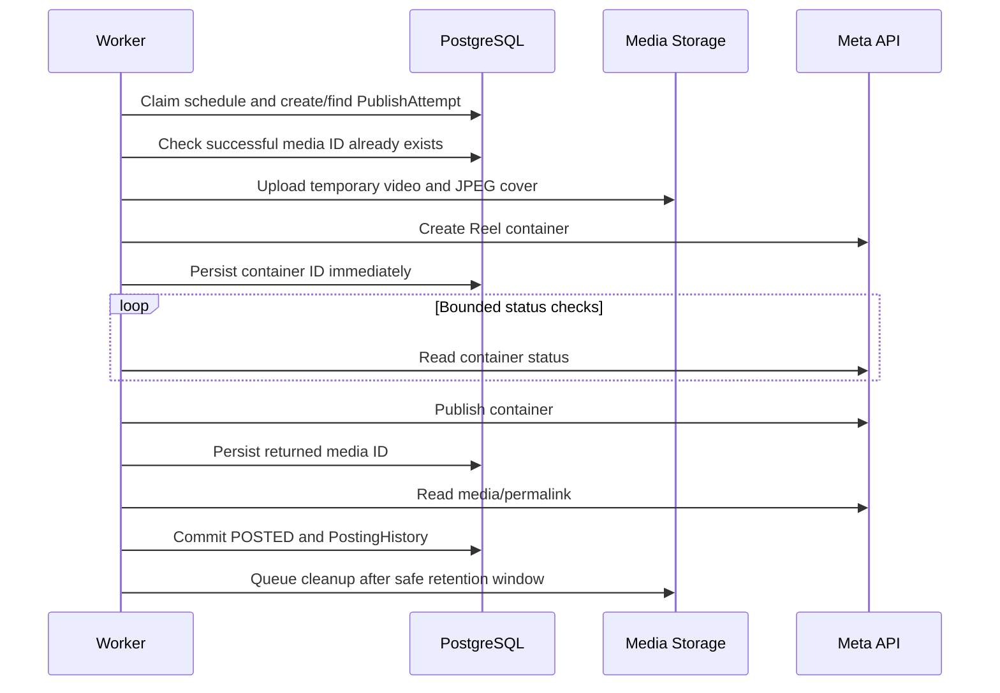

# Instagram Reels Automation — Project Blueprint

**Status:** Architecture and design-system plan  
**Date:** 27 October 2026  
**Project type:** Greenfield  
**Business timezone:** `Asia/Kolkata`  
**Default publishing slots:** `19:00` and `20:00`  
**Production publishing default:** OFF

## 1. Product goal

Create a reliable team workflow that receives a video, joins separately supplied title and thumbnail by permanent Video ID, requires human approval, selects eligible reels using face-rotation rules, generates caption content, schedules two fixed daily slots, publishes through Instagram, and exposes every decision and failure in an operator dashboard.

The system should automate routine work without hiding uncertainty. PostgreSQL is authoritative. Google Drive stores source assets. Google Sheets is a human coordination surface and mirror, not the workflow database.

## 2. Confirmed business rules

| Rule                 | Decision                                                                   |
| -------------------- | -------------------------------------------------------------------------- |
| Permanent identity   | `GCS-0001` style Video ID                                                  |
| Relationship key     | Video ID; never title or filename similarity                               |
| Daily limit          | Maximum 2 reels                                                            |
| Slots                | 19:00 and 20:00 IST                                                        |
| Face rule            | Same face cannot appear twice on one calendar day                          |
| Face gap             | If posted 27 Oct, blocked 28 Oct, eligible 29 Oct                          |
| Selection order      | Oldest eligible `READY` video first                                        |
| Approval             | Human `APPROVED` required before selection                                 |
| Duplicate publishing | A successfully posted video can never be published again                   |
| Partial capability   | Unsupported optional Meta feature becomes manual action, not total failure |
| Time storage         | UTC instants in database; business decisions in `Asia/Kolkata`             |

The times displayed in the supplied workflow image are superseded by 19:00 and 20:00.

## 3. Scope

### MVP

- Drive video and thumbnail discovery
- Google Sheet input/mirror sync
- Permanent Video ID allocation
- Face, title, thumbnail, and approval workflow
- Typed status state machine and validation
- Atomic daily selection and face rotation
- Structured caption, hashtag, and CTA generation
- Persistent BullMQ scheduling
- Temporary public media preparation
- Instagram Reel publishing and reconciliation
- Duplicate-post protection
- Role-aware operations dashboard
- Audit logs, health checks, alerts, and recovery controls

### Not in the first release

- Mobile application
- AI-generated official titles
- Automated creative editing or thumbnail generation
- Multi-brand or multi-Instagram-account tenancy
- Social engagement automation
- Unverified promises that every optional Instagram feature is available to the account

## 4. Recommended architecture

Use a **modular monolith with three deployable processes** in a `pnpm` TypeScript monorepo:



### Why this shape

- One domain model avoids duplicated workflow logic.
- API and worker can deploy, restart, and scale independently.
- PostgreSQL transactions can protect selection and publishing invariants.
- External services remain replaceable adapters.
- A microservice split is unnecessary at this scale and would add failure modes.

### Technology choices

| Layer           | Choice                                                              |
| --------------- | ------------------------------------------------------------------- |
| Runtime         | Node.js LTS + TypeScript strict mode                                |
| Package manager | pnpm workspaces                                                     |
| API             | Fastify + Zod/OpenAPI                                               |
| Admin           | Next.js App Router + Tailwind CSS                                   |
| Database        | PostgreSQL + Prisma                                                 |
| Jobs            | BullMQ + Redis                                                      |
| Logging         | Pino structured JSON                                                |
| Time            | Luxon initially; isolate time calculations behind domain helpers    |
| Tests           | Vitest, Fastify inject/Supertest where appropriate, Testcontainers  |
| Google          | Official `googleapis` Node client                                   |
| AI              | Official OpenAI Node SDK with schema-constrained output             |
| Instagram       | Version-pinned Meta Graph API adapter                               |
| Storage         | Provider-independent interface; Cloudinary primary, local for tests |

## 5. Repository structure

```text
apps/
  api/                  Fastify routes, auth, webhooks, health
  worker/               BullMQ processors and repeatable schedulers
  admin/                Next.js operations dashboard
packages/
  core/                 Entities, rules, state machine, selection policy
  database/             Prisma client and repositories
  integrations/         Google, OpenAI, Meta, and media-storage adapters
  config/               Typed environment/settings resolution
  observability/        Logger, metrics, correlation IDs
  testing/              Factories, fakes, external-service contracts
prisma/
  schema.prisma
  migrations/
docs/
  architecture decisions and operator setup added as implementation starts
```

Package boundaries must reflect behavior, not technical fashion. `core` cannot import Google, Meta, Next.js, Fastify, Prisma, Redis, or environment variables.

## 6. Domain model

### Primary records

| Entity              | Purpose                           | Critical constraints                        |
| ------------------- | --------------------------------- | ------------------------------------------- |
| `Video`             | Central workflow record           | unique `videoId`; unique Drive file ID      |
| `Face`              | Person/rotation identity          | stable ID; active flag                      |
| `Thumbnail`         | Approved cover asset              | belongs to one Video; Drive/storage IDs     |
| `Content`           | Generated caption payload         | versioned; model/prompt version recorded    |
| `ApprovalEvent`     | Append-only human decision        | approver, state, reason, timestamp          |
| `Schedule`          | One video in one slot             | unique video; unique scheduled instant      |
| `PublishAttempt`    | Reconciliation/idempotency record | deterministic key; unique successful video  |
| `PostingHistory`    | Immutable successful outcome      | unique video and Instagram media ID         |
| `AutomationSetting` | Safe runtime configuration        | typed key/value, version, audit actor       |
| `AuditLog`          | Append-only operational history   | actor, action, entity, before/after summary |
| `SyncCursor`        | Google incremental sync position  | one cursor per source/account               |

### Ownership rules

- Video Team owns the source video.
- Content Team owns the manual title.
- Design Team owns the thumbnail.
- Approver owns approval state.
- Automation owns derived workflow status, generated content, schedule, and posting result.
- Google Sheet edits must never overwrite automation-owned fields without an explicit command path.

## 7. Workflow state machine

Use a single current `workflowStatus` plus separate `approvalStatus`, job, and attempt records. Do not encode every external sub-state into one oversized enum.



Validation recalculates the most specific waiting state. `POSTED` is terminal for automated publishing. If an optional action such as collaborator acceptance remains, the Reel still stays `POSTED` and carries a separate `manualActionRequired` flag and reason. Rejection or requested changes returns the record to `WAITING_APPROVAL`, never to `READY`.

## 8. Selection and scheduling design

Selection is one database transaction:

1. Acquire a PostgreSQL advisory lock for the target local date.
2. Read existing schedules and posting history for that date.
3. Lock eligible `READY` videos using `FOR UPDATE SKIP LOCKED` through a narrow repository query.
4. Sort by `readyAt`, then permanent Video ID for deterministic ties.
5. Exclude posted, scheduled, actively publishing, same-day faces, and faces within the configured calendar-day gap.
6. Select up to the number of open slots; never weaken face rules to fill a slot.
7. Create `Schedule` rows and deterministic BullMQ job IDs in the same logical operation using an outbox record.
8. A dispatcher enqueues committed outbox records and marks them delivered.

Recommended job key: `publish:{videoId}:{scheduledAtUtc}`. Database uniqueness, not Redis alone, is the final duplicate guard.

## 9. Publishing safety and reconciliation



If the publish request times out after Meta may have accepted it, do **not** create another container or republish immediately. Move to `RECONCILE_REQUIRED`, inspect the stored container and account media, then decide whether retry is safe.

External errors are classified as `TRANSIENT`, `RATE_LIMIT`, `AUTH`, `VALIDATION`, `PERMANENT`, `UNKNOWN`, or `MANUAL_ACTION_REQUIRED`. Only transient/rate-limit failures retry automatically with bounded exponential backoff and jitter.

## 10. External integration boundaries

### Google Drive and Sheets

- Use Drive API v3.
- Start with folder-scoped `files.list`; persist file IDs and checksums.
- Move to the Drive change feed after the initial inventory; persist `newStartPageToken`.
- Upsert by Drive file ID, never filename.
- Sheet rows carry Video ID and a row/version marker.
- Sync is bidirectional only for explicitly human-owned fields; all other columns are DB-to-Sheet mirrors.
- Record sync conflicts instead of silently choosing the latest timestamp.

### OpenAI

- Input: approved title plus brand prompt/version and safe context.
- Output schema: `{ caption, hashtags[], cta }`.
- Validate lengths, hashtag format, forbidden claims, and empty output before saving.
- Generated content is versioned and reviewable; it never changes the official title.
- Model name is configuration, not business logic.

### Instagram/Meta

- Use the container flow: create media container, check `status_code`, publish, then fetch media/permalink.
- Query the account publishing-limit endpoint before publishing and expose remaining capacity.
- Use public, time-bounded media URLs that remain valid throughout processing.
- Treat cover, collaborator, and user-tag parameters as adapter capabilities verified against the pinned Graph API version and the actual account permissions.
- Collaborators are invitations and may still require acceptance.
- Optional feature failure must not cause an already successful Reel to be marked failed.

Implementation must pin and test a Graph API version; upgrade through an explicit compatibility task, not an unreviewed URL change.

## 11. Queue topology

| Queue/job            | Trigger                          | Idempotency basis               |
| -------------------- | -------------------------------- | ------------------------------- |
| `sync-google`        | every 2–5 minutes + manual       | source + cursor/page token      |
| `validate-video`     | after relevant change            | video ID + input version        |
| `select-daily-reels` | daily before slots + manual      | local date                      |
| `generate-content`   | selection                        | video ID + title/prompt version |
| `prepare-media`      | before scheduled publish         | schedule ID                     |
| `publish-instagram`  | slot time                        | schedule ID                     |
| `reconcile-publish`  | uncertain response/status        | publish attempt ID              |
| `cleanup-media`      | delayed after completion/failure | storage asset ID                |
| `mirror-sheet`       | outbox event                     | event ID                        |

BullMQ supplies delivery and retry mechanics; PostgreSQL holds business truth. Repeatable jobs must tolerate running twice.

## 12. API surface

Version routes under `/api/v1`.

| Area       | Representative endpoints                                                       |
| ---------- | ------------------------------------------------------------------------------ |
| Videos     | `GET /videos`, `GET /videos/:id`, `PATCH /videos/:id/title`                    |
| Thumbnail  | `POST /videos/:id/thumbnail`                                                   |
| Approval   | `POST /videos/:id/approval`                                                    |
| Schedule   | `GET /schedule/today`, `POST /selection/run`, `POST /schedules/:id/reschedule` |
| Failures   | `GET /failures`, `POST /publish-attempts/:id/retry-safe`                       |
| Automation | `GET/PATCH /settings`, `POST /automation/pause`, `POST /automation/resume`     |
| Audit      | `GET /audit-events`                                                            |
| Operations | `GET /health`, `GET /readiness`, `GET /queue-health`                           |

Every mutation requires authentication, role authorization, Zod validation, an idempotency key where relevant, and an audit event. Dangerous actions require a typed confirmation phrase in the UI and a second server-side authorization check.

## 13. Roles and permissions

| Capability              | Admin | Video Team | Content Team | Design Team | Approver |
| ----------------------- | :---: | :--------: | :----------: | :---------: | :------: |
| Upload/link video       |  Yes  |    Yes     |      No      |     No      |   View   |
| Edit title              |  Yes  |    View    |     Yes      |    View     |   View   |
| Upload thumbnail        |  Yes  |    View    |     View     |     Yes     |   View   |
| Approve/reject          |  Yes  |     No     |      No      |     No      |   Yes    |
| Operate queues/settings |  Yes  |     No     |      No      |     No      |    No    |
| Safe retry/reschedule   |  Yes  |     No     |      No      |     No      |    No    |
| View audit/status       |  Yes  |  Limited   |   Limited    |   Limited   |   Yes    |

Use a server-side session provider and database roles/permissions. Never store Meta, OpenAI, Google, database, or storage credentials in the browser.

## 14. Dashboard information architecture

### Navigation

1. **Overview** — operational health, today’s two slots, blockers
2. **Videos** — searchable workflow table with ownership filters
3. **Approvals** — focused review queue with preview, title, cover, and history
4. **Schedule** — calendar/list of selected, scheduled, and posted reels
5. **Failures** — actionable incidents, retry classification, reconciliation state
6. **Audit log** — immutable event timeline
7. **Settings** — scheduling, rotation, prompts, integrations, automation switch

### Overview hierarchy

- First row: automation state, API/worker/DB/Redis health, last successful sync.
- Second row: Today at 19:00 and 20:00, each with video, face, status, and next action.
- Third row: actionable counts—Waiting, Ready, Scheduled, Failed, Manual Action.
- Lower sections: recent changes and integration warnings.

Counts always link to the exact filtered list that produced them.

## 15. Visual design system

### Design principles

- **Operational clarity:** status and next action appear before secondary metadata.
- **Evidence over decoration:** timestamps, actor, job/attempt IDs, and reasons are visible.
- **Safe control:** destructive or production-affecting actions cannot look like ordinary buttons.
- **Consistent density:** desktop tables for scanning; mobile uses cards, never squeezed wide tables.
- **Accessible states:** never communicate status through color alone.

### Foundations

Use Inter or Geist for UI, and JetBrains Mono for IDs/log fragments. Base spacing is 4 px. Default content width is fluid with a 1440 px comfortable maximum.

```css
/* Semantic tokens; implementation may map these to Tailwind variables. */
:root {
  --bg-canvas: #f6f8fb;
  --bg-surface: #ffffff;
  --bg-subtle: #eef2f7;
  --text-primary: #172033;
  --text-secondary: #5b667a;
  --border-default: #d7dee8;
  --action-primary: #2457d6;
  --status-waiting: #b7791f;
  --status-ready: #16844a;
  --status-scheduled: #5b4bc4;
  --status-posted: #087f8c;
  --status-failed: #c73535;
  --status-manual: #a64b00;
  --focus-ring: #6ea8fe;
  --radius-sm: 6px;
  --radius-md: 10px;
  --radius-lg: 14px;
  --shadow-card: 0 1px 2px rgb(16 24 40 / 6%), 0 6px 18px rgb(16 24 40 / 5%);
}
```

Target WCAG 2.2 AA. Body text is at least 14 px on dense desktop screens and 16 px on mobile; interactive targets are at least 44 × 44 px.

### Component set

- `AppShell`, `SideNav`, `TopBar`, `Breadcrumbs`
- `HealthStrip`, `MetricCard`, `ScheduleSlotCard`
- `StatusBadge` with icon + label, `ApprovalBadge`, `IntegrationBadge`
- `VideoTable`, `VideoMobileCard`, `FilterBar`, `SavedView`
- `VideoPreview`, `ThumbnailPreview`, `FaceChip`
- `ApprovalPanel`, `ChangeHistory`, `AuditTimeline`
- `EmptyState`, `ErrorState`, `Skeleton`, `InlineAlert`
- `ConfirmActionDialog`, `TypedConfirmationDialog`
- `JobDetailsDrawer`, `LogViewer`, `RetryDecisionPanel`
- `FormField`, `Select`, `DateTimeField`, `SettingRow`

### Status language

UI labels should be human-readable while retaining the machine code in details:

| Machine state            | UI label            | Primary next action  |
| ------------------------ | ------------------- | -------------------- |
| `WAITING_FACE`           | Face needed         | Assign face          |
| `WAITING_TITLE`          | Title needed        | Add title            |
| `WAITING_THUMBNAIL`      | Thumbnail needed    | Upload thumbnail     |
| `WAITING_APPROVAL`       | Awaiting approval   | Review               |
| `READY`                  | Ready for selection | No action            |
| `FAILED`                 | Action required     | Inspect failure      |
| `MANUAL_ACTION_REQUIRED` | Manual follow-up    | Complete listed step |

## 16. Security and privacy

- Secrets live in deployment secret stores or local `.env`, never Git, Sheet, DB plaintext views, logs, or frontend bundles.
- OAuth tokens are encrypted at rest with a rotatable application key.
- Apply least-privilege Google scopes and Meta permissions.
- Verify webhook signatures and reject replay outside a bounded timestamp window.
- Validate MIME type by content, extension, duration, dimensions, codec, and size.
- Rate-limit login, mutation, sync, selection, retry, and publish controls.
- Temporary media is unguessable, time-bounded, and deleted after a retention delay.
- Maintain append-only approval and audit records.
- Production publish requires both `AUTOMATION_ENABLED=true` and an account/environment marked production-ready.

## 17. Observability and operations

Every log/event should carry available identifiers: `requestId`, `videoId`, `faceId`, `scheduleId`, `jobId`, `publishAttemptId`, `operation`, `durationMs`, and `errorCode`.

Minimum operational signals:

- Google sync age and last outcome
- READY inventory by waiting reason
- Slot occupancy and missed-slot count
- Queue depth, oldest job age, retry/dead-letter count
- Container processing duration
- Publish success/failure rate
- Reconciliation backlog
- Temporary asset cleanup backlog
- Expiring/invalid credentials without exposing token values

Alerts should be actionable: missed scheduled slot, uncertain publish result, auth failure, repeated rate limit, worker heartbeat loss, DB/Redis failure, or media cleanup breach.

## 18. Test strategy and acceptance gates

### Test layers

- Unit: state machine, waiting-state calculation, face-gap calendar logic, prompt/output validation.
- Property/invariant: never more than two schedules/day; never duplicate video; never same face/day.
- Database integration: transactions, locks, unique constraints, outbox delivery.
- Adapter contracts: Google, OpenAI, storage, Meta fixtures and error mapping.
- Worker integration: retries, restarts, dead letters, reconciliation.
- Browser E2E: role permissions and core operator journeys.
- Staging smoke: real OAuth and media processing against a non-production account.

### Release-blocking scenarios

- Stable ID on repeated Drive discovery
- Human/system Sheet field conflicts are surfaced
- Missing face/title/thumbnail/approval produces correct waiting state
- Same face is blocked on same day and configured gap day
- One eligible face fills only one slot
- Concurrent selectors cannot double-select
- Timezone behavior across UTC date boundaries
- Queue restart does not lose a schedule
- Timeout after possible Meta acceptance reconciles before retry
- Posted video can never return to publishable state
- Production switch defaults OFF
- No real publishing occurs during automated test runs

## 19. Delivery roadmap

| Phase                     | Outcome                                                        | Exit gate                      |
| ------------------------- | -------------------------------------------------------------- | ------------------------------ |
| 0. Discovery              | Accounts, folders, Sheet, deployment and permissions inventory | unknowns/blockers recorded     |
| 1. Foundation             | Monorepo, config, logging, DB, Redis, health, CI               | lint/typecheck/test green      |
| 2. Domain                 | Schema, IDs, status/approval rules, audit                      | domain invariants tested       |
| 3. Google                 | Initial + incremental Drive/Sheet sync                         | repeat sync is idempotent      |
| 4. Selection              | Atomic rotation and two IST slots                              | concurrency/time tests green   |
| 5. Content                | Structured caption generation                                  | schema and safety tests green  |
| 6. Queue/media            | Persistent jobs and expiring public assets                     | restart and cleanup proven     |
| 7. Meta staging           | Container, status, publish, permalink, reconcile               | controlled staging post proven |
| 8. Dashboard              | Role-aware operations interface                                | core journeys pass E2E         |
| 9. Production readiness   | alerts, backup/restore, runbooks, security review              | launch checklist signed off    |
| 10. Production enablement | guarded live rollout                                           | explicit human authorization   |

### Recommended first milestone

Build a vertical slice that stops before external publishing:

1. Create monorepo and local Docker services.
2. Implement schema, permanent ID generation, workflow state machine, and audit log.
3. Import five fixture videos across three faces.
4. Validate approval and face rotation.
5. Atomically select 19:00 and 20:00 slots.
6. Show the real state in a minimal read-only dashboard.

This milestone proves the hardest business rules without requiring Google, OpenAI, or Meta credentials.

## 20. Human-only setup blockers

These do not block foundation/domain development, but must be completed before live integration verification:

- Authorize Google OAuth for the account that owns or can access the Drive folder and Sheet.
- Confirm the Instagram account is Professional and choose the supported Meta login path.
- Authorize the Meta app/account permissions and complete any required business verification or app review.
- Provision production PostgreSQL, Redis, object storage, and deployment accounts.
- Explicitly approve the first real staging and production Reel publish.

Never send passwords or long-lived secrets in chat. Store them in local/deployment secret configuration.

## 21. Architecture decisions to keep

1. PostgreSQL is the only automation source of truth.
2. Video ID is permanent and asset relationships are explicit.
3. Core rules live in a framework-independent domain package.
4. API, worker, and admin are separate runtimes, not separate product domains.
5. Selection and duplicate protection rely on database invariants and locks.
6. Queue delivery is at-least-once; every handler is idempotent.
7. Optional Meta features are capabilities with manual fallback.
8. Production publishing is opt-in and remains OFF until staging acceptance.

## 22. Reference links

- [Meta Instagram Content Publishing](https://developers.facebook.com/docs/instagram-platform/content-publishing/)
- [Meta Instagram API collection](https://www.postman.com/meta/instagram/documentation/6yqw8pt/instagram-api)
- [Google Drive change feed](https://developers.google.com/workspace/drive/api/guides/manage-changes)
- [Google Drive API v3 file listing](https://developers.google.com/workspace/drive/api/reference/rest/v3/files/list)
- [OpenAI structured outputs](https://platform.openai.com/docs/guides/structured-outputs)
